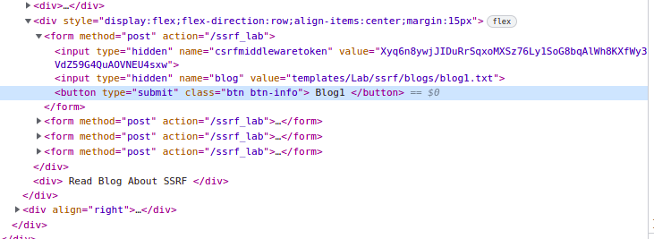
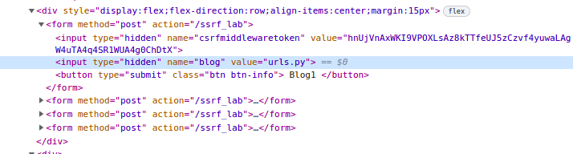
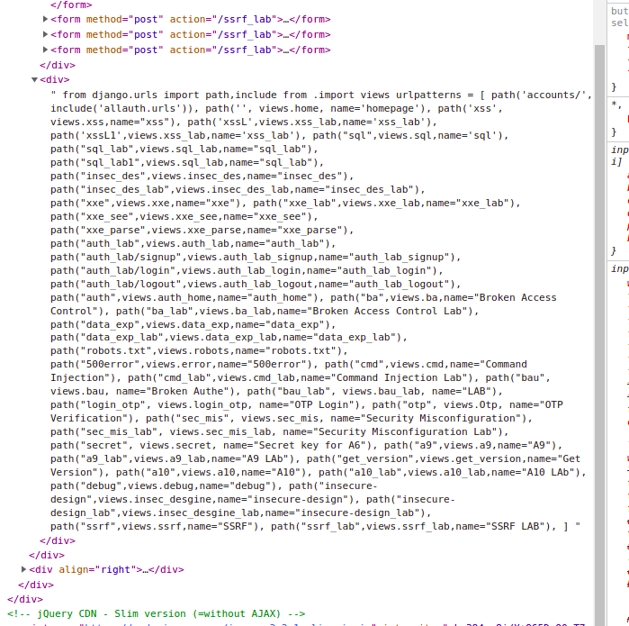
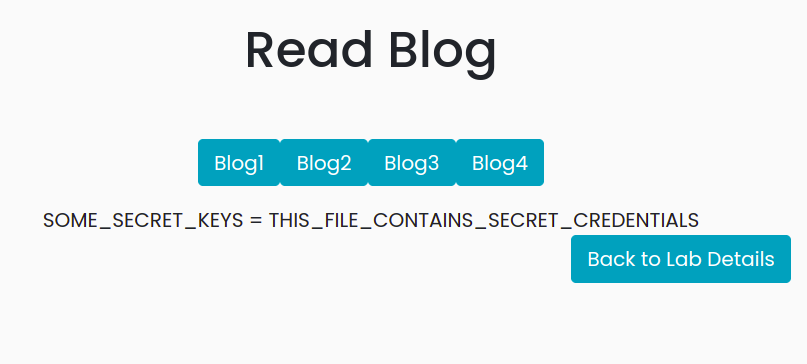

# Arbitrary file read through the blog path

Lab 5 DevSecOps | Individual finding | 22 November 2026

**Severity: Medium (CVSS v3.1: 6.5)**  
**Classification: CWE-22, path traversal**  
**Analysed commit:** `09e8a08909c82e518f6ac0a4554c1fc0f95ac8d6`  
**Affected endpoint:** `POST /lab1` in `dockerized_labs/ssrf_lab/app.py`, lines 15-25

At the analysed commit, the blog reader took the `blog` form parameter as a file path and returned the file's contents. A user could replace the hidden field's value with a path outside the intended `blogs` directory. This finding is listed under the SSRF lab in `Solutions/solution.md`, but the specific weakness is unrestricted local file reading through path traversal. The fix is described below.

## How the issue was identified

The supplied [solution](../../Solutions/solution.md) describes changing the hidden `blog` field and using `../.env` to read a configuration file. Its screenshots show the field, an example of requesting another application file, and a page displaying a secret-looking value. These are existing solution materials, not screenshots from a test performed for this report.



*Figure 1. The hidden `blog` field selects a blog file.*





*Figures 2-3. The solution changes the field to `urls.py` and shows application source in the response.*



*Figure 4. The solution describes using `../.env`; its screenshot shows the resulting value in the blog area.*

## Why the original code was vulnerable

The form submitted a hidden `blog` field with values such as `blogs/blog1.txt`. The handler read the submitted value directly:

```python
file = request.form.get("blog")
file_path = os.path.join(os.path.dirname(__file__), file)
with open(file_path, "r") as f:
    blog_content = f.read()
return render_template("lab1.html", blog=blog_content)
```

The original code did not restrict the resolved path to `blogs`. A value such as `app.py` selected a file outside that directory; a path containing `../` could reach a parent directory if a readable file was present there. The `try/except` only changed the response when opening failed. It did not prevent access to a readable file.

## Impact and severity

Before the fix, the attacker needed access to the lab endpoint and could read text files available to the Flask process. Depending on the files deployed with the service, this could disclose source code, configuration, or credentials. The original code did not show a way to modify files or execute commands through this endpoint.

For the main Docker Compose deployment, the lab router is configured with Traefik ForwardAuth in `challenge/views.py`, and `docker-compose.yml` sets `LAB_FORWARD_AUTH_URL`. Assuming that gateway is used and a normal account is required, the estimated CVSS v3.1 vector is:

```text
CVSS:3.1/AV:N/AC:L/PR:L/UI:N/S:U/C:H/I:N/A:N = 6.5 (Medium)
```

The high confidentiality impact reflects the ability to read any text file accessible to the process, subject to filesystem permissions. Integrity and availability are unchanged by this read operation. A standalone lab exposed directly without the authentication gateway would have a different privileges-required metric and severity.

## Implemented fix

The [handler](../../dockerized_labs/ssrf_lab/app.py) now maps the submitted identifier to one of four fixed filenames. The [form](../../dockerized_labs/ssrf_lab/templates/lab1.html) sends `blog1` through `blog4` instead of paths. An unknown identifier returns `No blog found` before any file is opened.

```python
blog_file = BLOG_FILES.get(request.form.get("blog"))
if blog_file is None:
    return render_template("lab1.html", blog="No blog found")
with open(os.path.join(BLOG_DIR, blog_file), "r", encoding="utf-8") as f:
    blog_content = f.read()
```

Because the value used in `os.path.join()` comes from the server-side allowlist, changing the hidden field to `app.py`, `../.env`, or another path no longer selects a file. The obsolete `.env` hint and vulnerable code example were also removed or updated in the lab page.

## Verification scope

The initial finding is based on the supplied solution, its screenshots, and source review. After the fix, I ran focused Flask test-client checks with `python -m unittest dockerized_labs.ssrf_lab.test_app`: **2 tests passed**. The checks confirmed that `blog1` still returns blog content while `app.py`, `../.env`, and the old path value `blogs/blog1.txt` all return `No blog found`. No full application deployment or security scanner was run.
