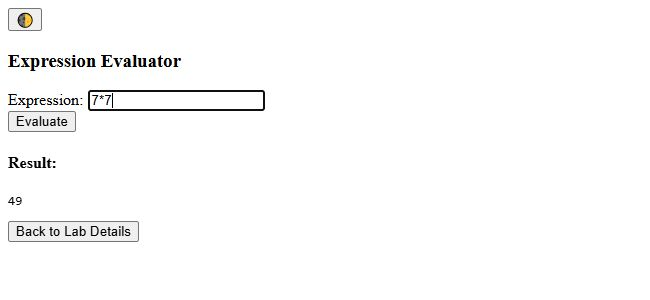
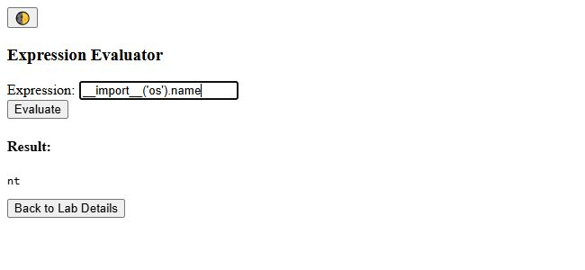

# Python code injection in PyGoat

Lab 5 DevSecOps   |   Task 4 individual finding   |   20 November 2026

I selected an unsafe use of eval() in the PyGoat expression evaluator. The application passes text from an HTTP form directly to Python. Bandit reported this as a Medium finding, and a local check showed that the input can import a Python module.

Repository: [Retr0-46/lab5-NCS](https://github.com/Retr0-46/lab5-NCS)   |   Analysed commit: 8504a7d

Affected endpoint: POST /lab2  
File: dockerized_labs/command_injection_lab/app.py, line 49

## How I found the issue

I used Bandit 1.9.4 to scan the Python source with the same severity and confidence filters as the team workflow. The full scan produced 53 findings: 23 High and 30 Medium. I then selected rule B307 to get a short report for this finding. [Bandit B307 documentation][eval-bandit]

```bash
python -m bandit -ll -ii -r . -f json -o bandit-report.json
python -m bandit -ll -ii -t B307 -r . -f txt -o bandit-b307.txt
```

The relevant part of the local text report was:

```text
Issue: [B307:blacklist] Use of possibly insecure function
Severity: Medium   Confidence: High
Location: .\dockerized_labs\command_injection_lab\app.py:49:21
49             output = eval(expression)
```

The team also has a CI run for the same commit. I include its link as workflow evidence. The specific B307 details above come from the local scan; I did not inspect the CI report artifact. [Related team CI run][eval-ci]

## Why the code is unsafe

I checked the source around the reported line. The parameter val is taken from the submitted form and passed to eval() without a check on allowed expressions. [Source file at commit 8504a7d][eval-source]

```python
expression = request.form.get("val", "")
output = eval(expression)
return render_template("lab2.html", output=str(output))
```

eval() can evaluate function calls and access Python objects. Here, a user can control what the server evaluates. The surrounding try/except only handles errors after evaluation has been attempted; it does not prevent unsafe code from running.

## CWE classification

I classify the issue as CWE-95, Eval Injection. MITRE describes this weakness as using untrusted input in dynamically evaluated code without properly handling code syntax. [MITRE CWE-95][eval-cwe] The raw Bandit report labels B307 as CWE-78, but CWE-95 is more specific to this Python eval() call. This report uses the CWE classification rather than a CVE for a library version.

## Local validation

I ran the original Flask lab on Windows at http://127.0.0.1:5013/lab2. The environment used Python 3.11.2, Flask 2.0.1, Werkzeug 2.0.1 and Jinja2 3.0.1. itsdangerous was pinned to 2.0.1 for compatibility. Only this module was started, so Docker was not needed for these checks.

First, I submitted a normal arithmetic expression:

```text
Input: 7*7
Observed result: 49
```



*Figure 1. The evaluator returns 49 for the normal input 7\*7.*

Next, I submitted an expression that imports a module and reads one of its attributes:

```text
Input: __import__('os').name
Observed result: nt
```



*Figure 2. User input imports the os module and returns its name attribute.*

The value nt matches the Windows environment used for the test. This shows that the evaluator accepts module access through user input. Both POST requests returned HTTP 200. I did not run operating system commands or read user files.

The source template clears the field after a POST, so I entered the same input again before each screenshot. The displayed response was unchanged. The source and templates were kept unchanged; the server was bound to loopback with debug disabled and was stopped after the checks.

## CVSS assessment

For a deployment where this Flask service is reachable over HTTP without a login requirement, I estimate CVSS v3.1 at 9.8, Critical. This is my assessment of that scenario, not an official score assigned to CWE-95. The local demonstration itself was restricted to loopback. I used the FIRST scoring rules. [FIRST CVSS v3.1 specification][eval-cvss]

```text
CVSS:3.1/AV:N/AC:L/PR:N/UI:N/S:U/C:H/I:H/A:H
```

| Metric | Value | Reason for this finding |
| --- | --- | --- |
| Attack Vector | AV:N | An attacker can send input over HTTP. |
| Attack Complexity | AC:L | No race condition or special timing is needed. |
| Privileges Required | PR:N | The directly accessed Flask handler has no login check. |
| User Interaction | UI:N | No other user needs to take an action. |
| Scope | S:U | The assessment stays within the application security scope. |
| Confidentiality | C:H | Python code may read data available to the process. |
| Integrity | I:H | Python code may modify data available to the process. |
| Availability | A:H | Python code may stop or disrupt the service. |

If access is only possible through the main PyGoat login and Traefik, the attacker needs an ordinary account. Changing PR to Low with the other metrics unchanged gives 8.8, High. The access configuration therefore matters when reporting the score.

## Impact and required privileges

Before exploitation, an attacker needs network access to the endpoint and, if enforced by the proxy, an ordinary account. After exploitation, injected code runs with the Flask process permissions. It could expose application secrets, change accessible files or interrupt the service. The two checks above demonstrate Python evaluation and module access; they do not demonstrate all of these possible impacts or a container escape.

## Suggested fix

I would remove eval() from the request handler. For a calculator, the application should parse only allowed arithmetic operations and limit input length and complexity. This report analyses the finding; a code patch and before-and-after scans would be separate bonus work.

## References

- [Source file at commit 8504a7d][eval-source]

- [Bandit B307 documentation][eval-bandit]

- [Related team CI run][eval-ci]

- [MITRE CWE-95][eval-cwe]

- [FIRST CVSS v3.1 specification][eval-cvss]

[eval-source]: https://github.com/Retr0-46/lab5-NCS/blob/8504a7d2f8b70a56fbb4e39aac3f02a5d0d7a933/dockerized_labs/command_injection_lab/app.py#L42-L50
[eval-bandit]: https://bandit.readthedocs.io/en/1.9.4/blacklists/blacklist_calls.html#b307-eval
[eval-ci]: https://github.com/Retr0-46/lab5-NCS/actions/runs/44706313582
[eval-cwe]: https://cwe.mitre.org/data/definitions/95.html
[eval-cvss]: https://www.first.org/cvss/v3.1/specification-document
